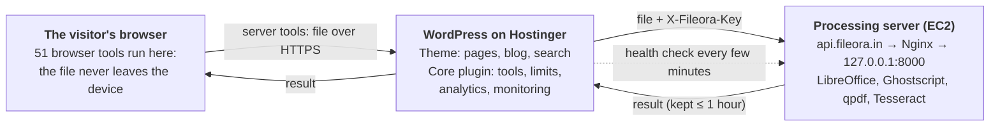
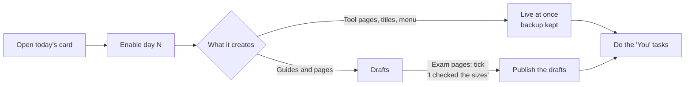

# Fileora Setup & Admin Guide

**Fileora Core plugin 2.11.0 · Fileora theme 2.8.0 · Processing server 2.3** · updated 22 October 2026

Fileora is a WordPress website with **70 free PDF and image tools**: 51 run in the visitor's browser and the rest on your own processing server. This one file covers all three parts: the **Core plugin**, the **theme** and the **processing server**.

> [!WARNING]
> **Security first.** Never post your shared key, server passwords or private keys in chats, tickets or screenshots. A key that was ever pasted anywhere must be treated as public: create a new one ([The shared key](#the-shared-key)).

---

## Contents

| | Section | For |
|---|---|---|
| 1 | [At a glance](#1-at-a-glance) | everyone |
| 2 | [What's in the package](#2-whats-in-the-package) | everyone |
| 3 | [The tools](#3-the-tools) | everyone |
| 4 | [Install and update](#4-install-and-update) | site owner |
| 5 | [Fileora Core plugin](#5-fileora-core-plugin) | site owner, Support |
| 6 | [Fileora theme](#6-fileora-theme) | site owner, editors |
| 7 | [Processing server on AWS EC2](#7-processing-server-on-aws-ec2) | server admin |
| 8 | [Hostinger settings](#8-hostinger-settings) | site owner |
| 9 | [How the numbers are calculated](#9-how-the-numbers-are-calculated) | everyone reading reports |
| 10 | [Troubleshooting, backups and recovery](#10-troubleshooting-backups-and-recovery) | site owner, server admin |
| 11 | [For developers](#11-for-developers) | developers |
| 12 | [Version history and testing](#12-version-history-and-testing) | everyone |

---

## 1. At a glance

Browser tools finish on the visitor's device. Only server tools send the file to WordPress, which checks it and forwards it to your EC2 server with the shared key.



<details>
<summary>Same picture as plain text</summary>

```
 Visitor's browser
   │  Browser tools: the file is processed on the device. Nothing is uploaded.
   │  Server tools: the file is sent to WordPress over HTTPS
   ▼
 WordPress on Hostinger  (theme + Fileora Core)
   │  checks size, type and daily limit, then forwards the file
   │  with the secret header X-Fileora-Key
   ▼
 Processing server on EC2  (https://api.fileora.in → Nginx → 127.0.0.1:8000)
      converts the file, keeps the result at most an hour, deletes it after download
```
</details>

---

## 2. What's in the package

Three parts, installed separately. The theme and the plugin are independent: switch the plugin off and the site stays a working blog; switch the theme and the tools still work inside any other theme.

| Part | File | Runs on | What it does |
|---|---|---|---|
| **Fileora Core plugin** 2.11.0 | `fileora-core-2.11.0.zip` | WordPress (Hostinger) | Tool registry and engine, settings, permissions, connection to the processing server, task records, visitor analytics, server monitoring, announcements, admin dashboards |
| **Fileora theme** 2.8.0 | `fileora-theme-2.8.0.zip` | WordPress (Hostinger) | The website: header with mega menu, homepage, tool catalogue, tool pages, search, blog, information pages, footer |
| **Processing server** 2.3 | `server/` folder | AWS EC2 (Ubuntu) | Python service with LibreOffice, Ghostscript, qpdf and Tesseract for tools a browser can't do (Word to PDF, OCR, Protect PDF) |

`fileora-website-2.11.0-complete.zip` holds all three plus this guide, `TEST-REPORT.md` and `docs/` (the blog plan keyword sheet and the Keyword Planner upload file).

---

## 3. The tools

70 tools in 7 categories. **Browser** tools never upload the file and work without the processing server.

| Category | Tools | Runs on |
|---|---|---|
| **PDF Tools** (30) | Merge, Split, Organize, Rotate, Crop, Page numbers, Watermark, Sign, PDF to JPG, JPG to PDF, Scan to PDF, PDF to Markdown, Compare PDF, Aadhaar Card Print, ID Card Print, Interleave PDF, Split Pages in Half, Remove Blank Pages, Pages per Sheet, Booklet Maker, Bates Numbering, Header & Footer, Edit PDF Metadata, Flatten PDF, Extract Images, Resize PDF Pages, Reverse / Duplicate Pages, PDF to Text, Dark Mode PDF, Add Stamp | Browser |
| **Image Tools** (21) | Compress, Resize, Convert, Crop, JPG to PNG, PNG to JPG, Compress to 20 KB, Exam Photo & Signature Resizer, Passport Photo, HEIC to JPG, Remove EXIF, Watermark Image, Rotate, Blur / Pixelate, Combine Images, Favicon Generator, SVG to PNG, **PNG & JPG to SVG** *(new in 2.4)*, Colour Palette, Image to Base64, Add Border | Browser |
| **File Converter** (8) | Word, Excel, PowerPoint to PDF; PDF to Word, Excel, PowerPoint; HTML to PDF (from a web address); **HTML Code to PDF** (paste code, new in 2.10) | Server |
| **File Optimizer** (4) | Compress PDF and Repair PDF *(hybrid)*, OCR PDF, PDF to PDF/A | Server / hybrid |
| **File Security** (3) | Protect PDF, Unlock PDF, Redact PDF | Server |
| **File Edit** (2) | PDF Forms; Edit PDF *(pending: "coming soon", switched off)* | Server |
| **AI Tools** (2) | AI PDF Summarizer, Translate PDF *(paid, off by default)* | Server + AI API key |

- **Hybrid tools** use the server when it is healthy and fall back to the browser version otherwise.
- **Every tool is a WordPress page** of the type *Tool* at a root address (`/merge-pdf/`, `/png-to-svg/`). Edit its title, description, text and FAQ like any page, and switch it on or off.
- **Limits** (Fileora → Settings): 100 MB per file, 20 files per task, 30 server tasks per visitor per 24 hours. Administrators are never limited; failures caused by the server don't count.

### PNG & JPG to SVG (new in 2.4)

`/png-to-svg/` traces PNG, JPG and WebP into **real vector paths** with ImageTracer.js (public domain), in a Web Worker so the page stays responsive.

| Option | Choices |
|---|---|
| Picture type | *Logo / icon* (2–32 colours) or *Black & white* for signatures, stamps and line art |
| Black & white | automatic or manual darkness level; black or dark-blue ink |
| Detail | Low / Medium / High |
| Remove the background | on = transparent SVG |

Best for logos, icons and signatures; photos give heavy files and the result says so. Nothing is uploaded. The page comes with written content, 7 FAQs and its own SEO title and description (also saved for Yoast and Rank Math).

### HTML Code to PDF (new in 2.10)

`/html-code-to-pdf/` turns the visitor's **own HTML and CSS** into a PDF: paste code (or open an .html file), watch the **live preview**, download a PDF with real, selectable text. The older *HTML to PDF* tool still saves a public web page from its address.

| Option | Choices |
|---|---|
| Page size | A4 · US Letter · Fit content (one page the size of the content) |
| Orientation, Margins | Portrait/Landscape · None/Small (6 mm)/Normal (12 mm); an `@page` rule in the code wins |
| CSS media | Print (uses `@media print`, like "Save as PDF") · Screen |
| Background colours and images | on/off |
| Run JavaScript | off by default |
| File name | the PDF's name |

How it is kept safe:

- **Preview**: in a sandboxed frame with its own origin, so pasted code can't read this site, its cookies or storage. With JavaScript off, a Content-Security-Policy blocks every script and inline handler in the code.
- **PDF**: made on the processing server by headless Chromium (server 2.3). The code is sent as a small .html file (up to 5 MB). Scripts are off unless the visitor turns them on, and the page can only load from the **public internet**: private networks, localhost, cloud metadata addresses and `file:` are blocked (tested). Files are deleted after the job like every other server tool.
- Without the processing server, *Print with my browser instead* under the preview still works.
- The code is kept in the visitor's browser for the session (sessionStorage), so a reload doesn't lose it; nothing is stored on the site.

---

## 4. Install and update

Requirements: **WordPress 6.4+**, **PHP 7.4+** (8.1+ recommended) and **HTTPS**.

### 4.1 First install

1. **Plugins → Add New → Upload Plugin** → `fileora-core-2.5.1.zip` → Install → **Activate**. The tool pages are created automatically.
2. **Appearance → Themes → Add New → Upload Theme** → `fileora-theme-2.5.1.zip` → Install → **Activate**. An *All tools* page is created.
3. **Settings → Permalinks** → **Post name** → Save.
4. **Settings → General → Tagline**, for example *Free PDF Tools to Merge, Compress & Convert Online*.
5. **Fileora → Settings**: processing server `https://api.fileora.in` and the shared key → **Test the connection**.
6. **Fileora → Settings → Privacy and Security pages**: contact email, website hosting (Hostinger) and processing server (Amazon Web Services, United States).
7. **Appearance → Starter content**: import the eight information pages and the four blog guides.
8. **Fileora → Settings → Location database and check** → download DB-IP City Lite, so visits get a country, state and city.
9. **Appearance → Customize → Fileora**: homepage headline, quick links, FAQ, footer, contact email, social links, colour.
10. Set up a real cron job ([Hostinger settings](#8-hostinger-settings)) and purge LiteSpeed Cache once.

### 4.2 Updating to 2.11

1. Coming from 2.9 or older: update the **processing server** to 2.3 first (section 7.2) – HTML Code to PDF and the four new OCR/AI languages need it. Then upload **fileora-core-2.11.0.zip** and **fileora-theme-2.8.0.zip** with **Replace current with uploaded**. Open any admin page once: the **ATS Resume Builder** page and its header link are created (section 5.8). Nothing on the site changes until you enable a day.
2. Go to **Fileora → SEO → 70-day blog plan** and enable **day 1** (or carry on where you are: days 1–69 are unchanged, day 70 is new). Then come back each day (section 5.7). The 60-day plan carries on as before (section 5.6); the two plans are independent.
3. Coming from a version older than 2.5? Also follow the steps below.

### Updating to 2.5 (from older versions)

1. Upload both zips with **Replace current with uploaded**. Statistics, pages and settings are kept.
2. **Appearance → Starter content → Information pages**: tick **Accessibility** and **Contact** → *Import selected*. They appear in the footer by themselves.
3. **Privacy Policy** (existing page): add the contact form, because it now collects a name, email address and message. In the *Information we process* table add the row *Contact form messages · When you send us a message · Your name, email address, topic and message, used only to answer you; kept `[fileora_privacy field="message_keep"]`.* and under *Data retention* the line *Contact form messages: `[fileora_privacy field="message_keep"]`.* (New installs already have this.)
4. **Fileora → Settings → Data retention**: check *Send contact messages to* and *Contact form messages* (days kept).
5. **Fileora → SEO → Site settings**: Google Search Console code (HTML tag), homepage title, default share image, organisation. Then work through **Pages overview**, weakest first.
6. Purge LiteSpeed Cache, then press **Mark as reviewed** on the Privacy and Security notice once you have checked the pages.

> [!NOTE]
> Since 2.3, **deleting the plugin keeps all data**, so you can also delete and re-upload. Data is removed only if Settings → *Data retention* → *Delete all Fileora data when the plugin is deleted* is ticked.

### 4.3 Coming from the old "Fileora" plugin

Activating Fileora Core imports the old settings and job history, switches the old plugin off and creates the tool pages at the same addresses. Delete the old plugin afterwards; never run both.

### 4.4 Using another theme

Each tool page shows its workspace inside any theme. To place tools anywhere:

```
[fileora tool="merge-pdf"]   one tool (by address or id)
[fileora_tools]              the whole catalogue, by category
```

---

## 5. Fileora Core plugin

**Visitor Analytics** has its own menu item below Dashboard and opens after login for everyone who may see reports. Everything else is under **Fileora**.

| Admin page | What you see and do |
|---|---|
| **Visitor Analytics** | Live dashboard, refreshed every minute without reloading ([5.1](#51-visitor-analytics)) |
| **Dashboard** | Active visitors, tool runs (30 days), completed and failed server tasks, success rate, average duration, availability, most-used tools, recent failures |
| **Server Monitoring** | Current status, **Check now**, availability for 24 h / 7 d / 30 d with coverage, response times, the server's report (version, workers, queue) |
| **Processing Tasks** | Every server task with filters, pages and CSV export |
| **Tool Management** | All tools: on/off, where they run, status, uses in 30 days, order; **Restore missing pages** |
| **Tool Categories** | Category names, descriptions, colours and order |
| **Announcements** | Popups and bars for visitors ([5.2](#52-announcements)) |
| **Messages** | Messages sent with the contact form ([5.4](#54-contact-form-and-messages)) |
| **SEO** | Pages overview with a score per page, and site SEO settings ([5.5](#55-seo-controls)) |
| **Settings** | Server and key, limits, analytics and IP options, location database, data retention, privacy page details, Blog Editor and Support permissions, Support account, analytics storage |

### 5.1 Visitor Analytics

1. **Period**: last 1 minute, 30 minutes, 24 hours, 7, 30 or 90 days, or a **custom date range**. Every number, chart and table follows it.
2. **Numbers**: total visits, unique visitors (first-time visitors underneath), active now, page views, tool runs (browser + server, failures shown), files processed.
3. **Visitors by location**: doughnut by country, state or city; top 8 plus "Other".
4. **Real-time traffic**: visitors per minute for the last 30 minutes, split by the 4 busiest countries; spikes are pointed out.
5. **Traffic over time**: per minute, hour or day, with visits, unique visitors, page views, tool runs, files, failures and the 3 busiest locations per interval.
6. **Visitors vs. tool runs**: daily, weekly or monthly over 7 to 365 days, or the period above.
7. **Tool usage**: views, browser and server runs, failures, success %, files and average time per tool.
8. **Latest file processing** and **Visits**: searchable, filterable tables with pages.
9. **Export data (CSV)**: visits, events, file processing, traffic per interval, daily totals or tool usage.

Location needs the location database (Settings → *Location database and check*). Admin visits are not counted, so test from a phone or a private window.

### 5.2 Announcements

Fileora → Announcements → **Add announcement**: title, message and display settings.

| Setting | Choices |
|---|---|
| Show it | on/off (the post must be published) |
| Start / Expires | date and time, site time zone; empty = now / never |
| How often | once per visit, once per day, every page |
| Position | centre popup, top bar, bottom bar, small card bottom right |
| Look | light, dark, highlight colour, colour picker |
| Button | optional label and link |
| Who sees it | everyone, first-time, returning, logged-in or not; device type; every page, homepage, tool pages, blog posts |
| Delay | seconds after the page opens |

**Preview on the site** shows it to you only, even when it is off. At most one popup and one bar show at a time; Esc closes the popup, and it becomes a bottom sheet on phones.

### 5.3 Roles and permissions

Fileora uses WordPress capabilities, never role names:

| Capability | Allows | Given to |
|---|---|---|
| `fileora_view_reports` | Dashboard, analytics, monitoring, tasks | Administrator; Blog Editor if allowed; Support |
| `fileora_manage_tools` | Tool Management, tool pages, categories | Administrator |
| `fileora_manage_settings` | Fileora Settings | Administrator |
| `fileora_view_ip` | Visitors' IP addresses | Administrator; Support if allowed |
| `fileora_manage_announcements` | Announcements | Administrator |
| `fileora_export_data` | CSV export of analytics | Administrator |

- **Blog Editor** writes posts and uploads media; Settings decides whether they publish, edit others' posts, delete posts and see reports. Create one under **Users → Add New → Role: Blog Editor**.
- **Support** sees Visitor Analytics, Dashboard, Server Monitoring and Processing Tasks, and edits only their own profile.
- **Messages and SEO** need `fileora_manage_settings` (administrators).
- **Creating the Support user**: Fileora → Settings → *Support account* → username `Support`, an email address and the initial password; tick *Require a new password at first login*. The password is stored only as a WordPress hash, never in code, settings or logs. With WP-CLI: `wp fileora support-user --email=support@your-domain --password='…'`.

### 5.4 Contact form and messages

Put `[fileora_contact]` on any page (the starter **Contact** page already has it).

| | |
|---|---|
| Fields | Name, email, topic (general, a tool isn't working, privacy or data request, accessibility, business, something else), message. Labels, error messages in words next to each field, works with the keyboard and screen readers |
| Where messages go | Saved under **Fileora → Messages** *and* emailed to *Settings → Send contact messages to* (empty = the privacy email, else the admin email). If the host can't send email, nothing is lost; the message page says "Email notification: not sent". **Reply by email** opens your mail program |
| Spam protection | No captcha and no third party: a hidden honeypot field, at least 3 seconds to fill the form, at most 5 messages per hour from one connection. Works on cached pages |
| Retention | Deleted after *Settings → Contact form messages* days (default 180), shown on the Privacy Policy and Contact pages through `[fileora_privacy field="message_keep"]` |

> [!TIP]
> Hostinger's PHP mail often lands in spam. Install an SMTP plugin (for example *WP Mail SMTP*) with your Hostinger email account so notifications arrive reliably.

### 5.5 SEO controls

Every **post, page and tool** has an **SEO** box under the editor (in the block editor: open *Meta Boxes* at the bottom).

| Field | What it does |
|---|---|
| Focus keyword | The phrase people search for; drives the checklist. One per page |
| Search keywords (up to 10) | Other ways people search for the page, one per line. A live list under the field shows which ones the text already uses (new in 2.7) |
| Title ideas | Plan posts carry 10 alternative titles; **Use as SEO title** copies one into the SEO title field, e.g. to test a new title for a post with impressions but few clicks (new in 2.7) |
| SEO title | The blue headline in Google (30–60 characters; the site name is added) |
| Meta description | The text under it (120–160 characters); also used when shared |
| Image when shared | For WhatsApp, Facebook, X and LinkedIn (1200 × 630 px). Else the featured image, else the default image |
| Advanced: noindex | Keeps the page out of Google and out of the XML sitemap |
| Advanced: canonical URL | Only when the page copies another page |

The box shows a **Google preview**, length bars and a **checklist** that updates while you type: keyword in the title, description, address, first paragraph and a subheading; title and description length; at least 300 words; image alt text; an internal link; a warning when another page already uses the same keyword; and, when search keywords are filled in, that at least 8 of them (or all, if fewer) appear in the text.

**Fileora → SEO → Pages overview** lists every published page, post and tool with its keyword, title/description length, words, score and the first things to fix, weakest first. **Site settings**: verification codes for Google Search Console, Bing, Yandex and Pinterest (paste the code or the whole `<meta>` tag), homepage title, default share image, X account, and your organisation's name, logo and social profiles (Organization and WebSite structured data on the homepage).

**Ready-written SEO text** (Appearance → Starter content → *SEO text for existing pages*): one click fills the **All tools** page with an SEO title ("Free Online PDF Tools – Every PDF & Image Tool in One Place"), meta description, focus keyword *free online pdf tools*, an intro line under the heading, and about 650 words below the tool list: popular tools with links, how to use them, why Fileora, a "Which tool should I use?" table and 5 FAQs (FAQ structured data). It replaces the page's current text after asking. The page's checks then pass 11 of 12 (only "keyword in the page address" stays open: keep `/all-tools/`, because changing an indexed address loses its ranking). On the All tools page the checklist also counts the tool list itself, as Google sees it. Pages now have an *Excerpt* field: on the All tools page it is the intro line under the heading.

Tool pages without their own SEO title now use "*Tool* Online Free – Fast, No Sign-up". When Yoast, Rank Math, AIOSEO, SEOPress or The SEO Framework is active, Fileora shows a note in the box and leaves titles, descriptions and verification to that plugin.

### 5.6 The 60-day SEO plan (new in 2.6)

**Fileora → SEO → 60-day plan** turns the SEO strategy into one card per day. Open today's card, read what it changes, press **Enable day N**, then tick the tasks under **You**.



| Days | What the buttons do | What you do |
|---|---|---|
| 1–30 | Homepage title and description; clean sitemap (no users or tags, archives noindex); header menu; full text, FAQ and SEO fields for **41 tool pages**; 15 English guides | Connect `https://api.fileora.in`, Search Console and Bing, speed checks, brand profiles, listings, screenshots, weekly reviews |
| 31–60 | **9 exam pages** (IBPS, SBI, SSC CGL, SSC CHSL, UPSC, RRB NTPC, NEET, JEE Main, CUET) with the resizer pre-set; **5 KB pages** (10, 30, 50, 100, 200 KB) with the compressor pre-set; the **exam size list**; 3 more English and **6 Hindi guides** | Check exam sizes against notifications, outreach emails, YouTube creators, title rewrites, page-2 improvements, final KPI review |

- **One day at a time.** Day N opens N–1 days after day 1 was enabled. Tick *Let me work ahead* to open every day now.
- **Tool pages change live** (their old text, FAQ and SEO fields are kept as a backup). **Guides and pages are created as drafts**; press **Publish the drafts** after reading them.
- **Exam pages wait for you.** Each has an *I checked the sizes against the official notification* box. Exam sizes were collected in October 2026 from summaries of the 2026 notifications and some sources disagree (SSC signature 4 × 2 cm vs 6 × 2 cm), so these pages publish only after you tick it.
- **Undo this day** restores tool text and SEO fields, the homepage title, the menu and the sitemap setting, and moves the day's unpublished drafts to the trash. Guides and pages already published stay online.
- An existing page or post with the same address is never overwritten; that item is skipped.
- Published guides appear automatically under **"Guides for …"** on the tool pages they name, so new content links into the tools.
- Hindi guides get `lang="hi"` on their page, for browsers, screen readers and Google.
- Preset pages use the tool shortcode with a preset: `[fileora tool="examphoto" preset="ibps"]` or `[fileora tool="imgkb" target="50"]`. Presets live in `seo-plan/presets.php`; update them, and the page text, when a new notification changes the sizes.
- Content files (Markdown) are in `seo-plan/tools`, `seo-plan/guides` and `seo-plan/pages`; the schedule is `seo-plan/plan.php`.
- Fileora → SEO → Site settings has a new switch, **Sitemap and archives**, which day 1 turns on.
- Since 2.7 every guide also has **10 search keywords** in its SEO box.

### 5.7 The 70-day blog plan (new in 2.7, days 54–69 in 2.9, day 70 in 2.10)

**Fileora → SEO → 70-day blog plan** works like the 60-day plan: one card a day, **Enable day N**, read, publish. Each day creates **one blog post for one tool**, so after 70 days every tool has its own article.

| Category | Posts | Tools |
|---|---|---|
| **PDF Tools** | 30 | Merge, Split, Organize, Rotate, Crop, Page numbers, Watermark, Sign, PDF to JPG, JPG to PDF, Scan to PDF, PDF to Markdown, Compare, Aadhaar print, ID card print, Interleave, Split pages in half, Remove blank pages, Pages per sheet, Booklet, Bates numbering, Header & footer, Metadata, Flatten, Extract images, Resize pages, Reverse & insert, PDF to text, Dark mode, Image or stamp |
| **Image Tools** | 21 | Compress, Resize, Convert, Crop, JPG to PNG, PNG to JPG, Compress to KB, Exam photo & signature, Passport photo, HEIC to JPG, Remove location, Watermark, Rotate & flip, Blur, Combine, Favicon, SVG to PNG, PNG & JPG to SVG, Colour palette, Image to Base64, Add border |
| **File Optimizer** | 2 | Compress PDF, Repair PDF |
| **PDF Tools, days 54–69** (new in 2.9) | 16 | Word to PDF, Excel to PDF, PowerPoint to PDF, PDF to Word, PDF to Excel, PDF to PowerPoint, HTML to PDF (*save a webpage as PDF*), OCR PDF, PDF to PDF/A, Protect PDF, Unlock PDF, Redact PDF, PDF Forms, AI Summarizer, Translate PDF, Edit PDF |

| **PDF Tools, day 70** (new in 2.10) | 1 | HTML Code to PDF – the post *How to convert HTML to PDF*; the same day writes the new tool page's full text, FAQ and SEO fields |

Notes on days 54–70:

- **AI Summarizer (day 67) and Translate PDF (day 68)** need a Claude API key on the processing server (section 7.4), and their tool pages are switched off until then. Their posts are created as drafts and **stay drafts** – *Publish* skips them – until the tool is switched on in Fileora → Tool Management, so no reader lands on a tool they can't use. Both posts say plainly that the PDF's text is sent to the Claude API by Anthropic.
- **Edit PDF (day 69)**: the editor screen isn't built yet, so the post *How to edit a PDF* shows how to make each common edit with the tools that work today (sign, header and footer, image or stamp, page tools, redact, PDF to Word and back). It never links to the unfinished tool. When the editor is ready, update the post.
- Some posts sit close to a 60-day guide (Word to PDF on mobile, PDF to Word formatting, removing a PDF password, scanned PDFs). They target different searches; if Search Console later shows both pages for the same query, merge the weaker one into the stronger and redirect it.

Every post has:

- an SEO title (25–60 characters), meta description (120–160), URL slug and **focus keyword** in the title, description, first paragraph and a subheading;
- **10 search keywords**: the "how to …" form, the "… for free" form, online/phone/no-software variations and long-tail phrases, each used naturally in the text (checked before release);
- **10 title ideas**, no more than 3 starting with "How to";
- step-by-step instructions, a tool button, a quick-reference table, 4 FAQs (FAQ structured data) and links to the tool, related tools, the category page and **only earlier posts**, so no link points at a draft.

**Six posts refresh an older guide at the same address** (merge, split, sign, scan, HEIC to JPG, Aadhaar print). The card says so. The old text, title, SEO fields and categories are backed up; the post keeps its address, its ranking and its old category and gets the new one too. **Undo** puts the old version back. All other posts are created as **drafts**: press **Publish** on the card after reading.

The "You" tasks: publish, then **Request indexing** in Search Console; every 7th day a short check of impressions and keyword volumes; on day 70 a review of titles.

> [!NOTE]
> **Keyword volumes are not guaranteed.** The keywords were chosen from how people describe each task, not from measured search volume. Upload `docs/keyword-planner-upload.csv` to Google Keyword Planner (*Get search volume and forecasts*) and check Search Console after a few weeks; change any keyword in the post's SEO box if a better variation turns up. `docs/fileora-blog-plan-keywords.xlsx` lists all 70 posts with meta data, the 700 keywords and the 700 title ideas.

**Cover images (new in 2.8).** Every post has its own cover image (1200 × 675 JPG, about 60 KB, made for Fileora, no stock photos). When a day is enabled, its image is added to **Media → Library** (file name = the post's address, e.g. `how-to-merge-pdf-files.jpg`), attached to the post, given descriptive alt text and set as the **featured image**. So when you press Publish, the cover is already on the post, on the blog page and in the WhatsApp/Facebook/LinkedIn preview: nothing to upload by hand.

- **Days you enabled before updating** get their images automatically: open any admin page after the update (a few posts per page load), or press **Add the missing cover images** on the blog plan tab, which appears while any enabled post has no featured image.
- A refreshed older post keeps its old featured image as a backup; **Undo** puts it back. Undo never deletes an image from the Media Library, and enabling the day again reuses the same image instead of uploading a copy.
- To use your own picture instead, just change the featured image in the post editor.

Files: posts in `seo-plan/blog/*.md`, schedule in `seo-plan/blog-plan.php`, images and alt texts in `seo-plan/blog-images/`.

### 5.8 ATS Resume Builder (new in 2.11)

A separate section at **/ats-resume-builder/**, linked as **ATS Resume** in the header. Visitors pick a template, fill in a form and download their resume as a PDF.

| Part | What it does |
|---|---|
| **4 templates** | *Classic* (Times, centred name; government, banking, academic), *Modern* (Helvetica, coloured headings; most private-sector jobs), *Compact* (smaller margins and spacing; freshers, one page), *Minimal* (airy, no rules). All are single-column with standard headings, real text and standard PDF fonts – what ATS software reads best. Colour (navy, teal, maroon, black), text size and A4/US Letter for each. |
| **Form** | Personal details and links; Summary, Experience, Education, Skills, Projects, Certifications, Achievements, Languages. Sections can be moved up or down and left out; entries can be added, moved and removed; "I work here now" shows *Present*. *Fill with an example* shows a complete resume. |
| **Live preview** | The preview **is** the PDF: it is typeset with pdf-lib and drawn with pdf.js, so pages and line breaks match the download exactly. |
| **ATS check** | 11 checks on the text read back from the PDF: readable text, name, email, phone, standard sections (freshers: Projects instead of Experience), length, bullets per job, results with numbers, dates, summary length, unsupported characters. Shows the exact text ATS software reads. Optional **job-ad comparison**: paste a job description to see which of its key words (including names like "Power BI") the resume uses and which are missing. |
| **Output** | Download PDF (`name-resume.pdf`, clickable email and links, PDF title and author set); *Copy as plain text* for application forms; *Save a copy (.json)* and *Open a saved copy* to continue on another device. |
| **Privacy** | Nothing is uploaded: no server, no processing server. The resume stays in the browser tab (sessionStorage) and on the device only if the visitor ticks *Remember on this device* (localStorage). *Clear all* (two clicks) removes it. |

Notes:

- The site never claims a "100% ATS score": the page and the ATS check say plainly that no tool can promise one.
- The PDF fonts (Helvetica, Times) cover English and other Latin-alphabet languages; ₹ becomes "Rs." and characters such as Devanagari are left out with a warning in the ATS check.
- The page (with a guide and FAQ under the builder, SEO title, description, focus keyword and 10 search keywords) is created **once**; the header link is added **once** to the menu in the *Header* location, just before *Contact us*. Delete either and it is not added back. Without an assigned menu, the theme's default header shows the link while the page exists. The 60-day plan's header menu (day 2) now includes it too.
- The theme gives the page a wide layout (`page-ats-resume-builder.php`), also after its address is changed. With 9 or more header links, the header search shrinks to its icon below 1680 px so nothing overflows.
- Files: plugin `includes/class-resume.php`, `public/js/fileora-resume.js`, `public/css/fileora-resume.css`, `public/img/resume/*.png`; theme `page-ats-resume-builder.php`, `inc/resume.php`.

---

## 6. Fileora theme

The theme draws the whole website. It works on its own as a blog theme; with Fileora Core it adds the tool catalogue, tool pages and search.

### 6.1 Customizing

| What | Where |
|---|---|
| Homepage headline (the page's H1), quick links, sections | Appearance → Customize → Fileora → Homepage. `{count}` and `{browser}` become live tool counts |
| Tool page text, line under the title, FAQ | Fileora → Tool Management → Edit. FAQ: question on one line, answer below, empty line between |
| Logo | Appearance → Customize → Site Identity |
| Favicon (browser tab icon) | Built in since theme 2.5.2: the Fileora mark in every size (ICO, SVG, 96 px, Apple 180 px, Android 192/512 px, maskable). To use your own, upload a square PNG of at least 512 × 512 px in Appearance → Customize → Site Identity → *Site Icon*; it replaces the built-in one everywhere |
| Highlight colour; category colours | Customizer; Tool Categories |
| Menus | Appearance → Menus: *Header*, *Footer column 1–4*, *Footer bottom links* (optional: without menus the theme builds links from your categories) |
| Accessibility button | On by default (Customize → Fileora → Header → *Show the accessibility button*). A round blue button at the bottom left opens a panel: text size (4 steps), high contrast, highlight links, readable font, text spacing, large cursor, stop animations, reset; with links to the Accessibility statement and Contact page. Choices are saved in the visitor's browser only. The Accessibility page is reached from this panel, so it is no longer listed in the footer |
| Header and footer animation | On by default (Customize → Fileora → Header → *Animate the header and footer*). GSAP 3.14 (served from the theme): header items slide in, a scroll-progress line under the header, menus and the mobile drawer open with motion, footer columns rise in, a soft colour glow drifts behind the footer, "Back to top" scrolls smoothly. Visitors whose device asks for reduced motion, or who choose *Stop animations*, see no movement |
| Contact us in the header | Added automatically after the menu links when a Contact page exists. If you use your own *Header menu* (Appearance → Menus), add the Contact page to it yourself |
| Footer credit | Appearance → Customize → Fileora → Footer: *Credit line* ("Website created by"), *Credit name* (@techdeployers) and *Credit link* (https://www.techdeployers.com). Empty name = no credit |

- Visitors can switch light and dark mode; the first visit follows their device.
- Fonts (Bricolage Grotesque, Geist; SIL Open Font License) are served from the theme itself, so no request goes to Google Fonts.
- Make code changes in a child theme so updates don't overwrite them.
- **Page width**: information pages (Privacy Policy, Contact, About…) use a wide 1120 px column; on phones every table in page text turns into one card per row, with the column names as labels.

### 6.2 Information pages

**Appearance → Starter content → Information pages → Import selected** creates eight editable pages, listed in the footer column *Information*:

| Page | Address | Contents |
|---|---|---|
| About Us | `/about-us/` | Purpose, tools, how files are handled, contact |
| FAQ | `/faq/` | 20 questions in four groups, with FAQ structured data |
| Security | `/security/` | Data flow for browser and server tools, storage, safeguards; no "100% safe" claims |
| Privacy Policy | `/privacy-policy/` | Files vs. analytics vs. logs, third parties, retention, rights (incl. India's DPDP Act 2023) |
| Disclaimer | `/disclaimer/` | Accuracy limits, user responsibility, liability "to the extent permitted by law" |
| Accessibility | `/accessibility/` | What the site does for keyboard, screen reader, zoom, contrast and reduced-motion users; known limitations; how to report a problem |
| Contact | `/contact/` | The contact form, tips for reporting a tool problem, privacy note |
| Sitemap | `/sitemap/` | All pages, tools and posts, updated automatically |

The pages **stay accurate by themselves** through shortcodes:

| Shortcode | Shows |
|---|---|
| `[fileora_data_flow]` | which tools run where, from the live tool settings |
| `[fileora_privacy_facts]` | what analytics record with the current settings |
| `[fileora_privacy field="…"]` | one value: `email`, `host_web`, `host_server`, `deletion`, `event_keep`, `task_keep`, `message_keep`, `ip_days`, `max_mb`, `site` |
| `[fileora_contact]` | the contact form |

When something they describe changes, administrators see a review notice with **Mark as reviewed**. The texts are a careful start, not legal advice.

### 6.3 Blog

- **Blog page** at `/blog/`: the newest post as a large card, topic chips, then the other posts.
- **Every post gets**: a table of contents, reading time, a progress bar, a "Tools used in this guide" box, share buttons (WhatsApp, X, Facebook, LinkedIn, Telegram, copy link), an author box and three related posts.
- **SEO without a plugin**: meta description, Open Graph tags and BlogPosting, Breadcrumb and FAQ structured data. With Yoast, Rank Math, AIOSEO, SEOPress or The SEO Framework active, the theme leaves this to that plugin.
- **Starter guides** (Appearance → Starter content → Blog guides): Aadhaar print, PDF to 100/200 KB, exam photo 20 KB, JPG to PDF on mobile. Review them once a year, because exam rules and fees change.

### 6.4 Accessibility

The site aims at WCAG 2.2 level AA. Built in:

| Area | What is there |
|---|---|
| Keyboard | Skip link, visible focus outline, every menu, option and dialog usable with Tab / Enter / Space / arrows; `/` opens tool search |
| Screen readers | Landmarks, one H1 and an ordered heading outline on every page, labelled buttons and icons, tool progress and results announced (live region) |
| Tools | A normal *Choose files* button (dragging is never required); marked areas (Blur, Crop) move with arrow keys, resize with Shift + arrows, Alt for fine steps, Delete removes |
| Visual | AA contrast in light and dark mode, text zoom to 200% without sideways scrolling, colour never the only signal |
| Motion | Animations and smooth scrolling off when the device asks for reduced motion |
| Forms | Visible labels, errors in words next to the field, focus moved to the first problem |

**Checked** with axe-core (WCAG 2.0/2.1/2.2 A and AA rules plus best practices) on 13 page types in light and dark mode: no violations. Automated tests don't find everything; the Accessibility page invites people to report problems.

---

## 7. Processing server on AWS EC2

The server runs the tools a browser can't do. WordPress reaches it over HTTPS at **api.fileora.in**; the service itself listens only on `127.0.0.1:8000` behind Nginx.

### 7.1 Size

Start with a **t3.medium** (2 vCPU, 4 GB) and `FILEORA_WORKERS=2`: about one worker per 2 GB of RAM. LibreOffice and OCR are the heavy parts.

### 7.2 Install or update

```bash
# first install, on the EC2 instance (Ubuntu 22.04 / 24.04)
scp -r server ubuntu@<ec2>:/tmp/fileora-server
ssh ubuntu@<ec2>
cd /tmp/fileora-server && sudo bash install.sh

# update an existing install
sudo cp /tmp/fileora-server/app.py /opt/fileora/app/app.py
sudo systemctl restart fileora
grep -c "def code2pdf" /opt/fileora/app/app.py          # must print 1 (server 2.3)
curl -s http://127.0.0.1:8000/health                     # must show "code2pdf": true

# OCR languages: the site offers 23. An existing server may have only English and Hindi:
sudo apt-get install -y tesseract-ocr-{hin,ben,tam,tel,mar,urd,guj,kan,mal,pan,ara,chi-sim,jpn,kor,fra,deu,spa,por,ita,rus,tur,ind}
tesseract --list-langs                                   # should list all of them"
```

### 7.3 HTTPS on api.fileora.in

1. **DNS** (Hostinger → Domains → DNS zone of fileora.in): A record `api` → your EC2 **Elastic IP**. Check with `nslookup api.fileora.in`.
2. **Nginx**: copy `server/deploy/nginx-api-proxy.conf` to `/etc/nginx/sites-available/fileora-api`, set `server_name api.fileora.in;`, enable it, then `sudo nginx -t && sudo systemctl reload nginx`.
3. **Certificate**: `sudo certbot --nginx -d api.fileora.in` (only after step 1 resolves).
4. **Security group** inbound rules: 22 (SSH) from *My IP* only; 80 and 443 from anywhere (certbot needs 80); **delete the rule for port 8000**.
5. **WordPress** → Fileora → Settings → Processing server `https://api.fileora.in` → **Test the connection**.

### The shared key

The key proves that a request comes from your WordPress.

1. Fileora → Settings → **Shared key**: empty the field and **Save** to generate a new 48-character key.
2. Put the same value on the server in `/etc/fileora/fileora.env` as `FILEORA_KEY=…` (mode 600, owner root), then `sudo systemctl restart fileora`.
3. Test the connection: "Key accepted" means both sides match.

### 7.4 AI tools (optional)

AI PDF Summarizer and Translate PDF need `ANTHROPIC_API_KEY` in `/etc/fileora/fileora.env`. Without it they stay switched off. They are marked paid: decide on pricing first.

### 7.5 What WordPress needs from the server

| Needed for | Endpoint / field | Status |
|---|---|---|
| All server tools | `POST /process/{tool}`, `GET /jobs/{id}`, `GET /jobs/{id}/file`, `DELETE /jobs/{id}` | Available |
| Health checks | `GET /health` → `ok`, `tools{}`, `queue{}` | Available |
| Edit PDF | an editing endpoint | Not built: shown as "coming soon" |
| AI tools | `/process/summarize`, `/process/translate` + API key | Code ready; needs key and pricing |
| Server CPU / memory / disk | none | Use EC2 CloudWatch |

---

## 8. Hostinger settings

Three settings on Hostinger decide whether large files upload and whether health checks run on time.

### 8.1 PHP limits

hPanel → Websites → Manage → **Advanced → PHP Configuration → PHP options**. Fileora → Settings warns you when PHP's upload limit is below the Fileora file-size limit.

| Setting | Value |
|---|---|
| `upload_max_filesize` | 128M |
| `post_max_size` | 128M |
| `max_execution_time` | 300 |
| `memory_limit` | 256M |

### 8.2 LiteSpeed Cache

**LiteSpeed Cache → Cache → Excludes → Do Not Cache URIs** → add `/wp-json/fileora/` and save. Purge all after every update.

### 8.3 Real cron

WordPress runs scheduled tasks only when someone visits. For reliable health checks, rollups and clean-up:

1. In `wp-config.php`, above "That's all, stop editing!": `define( 'DISABLE_WP_CRON', true );`
2. hPanel → **Advanced → Cron Jobs** → every 5 minutes (use your website's own address):

   ```
   wget -q -O - "https://bioticherbal.in/wp-cron.php?doing_wp_cron" >/dev/null 2>&1
   ```

If cron isn't running, the Fileora dashboard shows a warning.

---

## 9. How the numbers are calculated

Every figure on the dashboards comes from records stored in your WordPress database; nothing is estimated or sampled.

### 9.1 Availability

```
Availability = successful health-check time ÷ total monitored time × 100
```

- Each check covers the time until the next one, but at most two monitoring intervals. A gap with no checks is **unmonitored**, neither up nor down.
- **Coverage** = monitored time ÷ length of the window. Low coverage means cron isn't running.
- A check succeeds when `/health` answers HTTP 200 in time and accepts the key.

### 9.2 Tasks and runs

| Term | Meaning |
|---|---|
| Server task | One request to the processing server; completed or failed with an error code (`unreachable`, `auth`, `server_error`, `abandoned` after 2 hours…) |
| Browser run | Reported by the visitor's browser when a browser tool finishes; never counted as a server task |
| Tool runs | Browser runs + server tasks |
| Success rate | Completed ÷ (completed + failed); running tasks excluded |
| Average duration | Upload to finished result, completed tasks only |

### 9.3 Visitors and visits

| Term | Meaning |
|---|---|
| Visitor ID | Random id in the browser's localStorage; no cookies |
| Visit | Random id per tab session; ends after 30 minutes without activity |
| Unique visitors | Distinct visitor ids among the period's visits |
| Active now | Visits with activity in the last 5 minutes (a "still here" signal at most once a minute) |
| Files processed | Files in successful runs |

- **Recorded per visit**: first and last activity, approximate location, IP address (full, shortened or none), landing page, referring site, device, browser and system. Per tool run: tool, result, duration, number of files and the first file name. **Never file contents or passwords.**
- Bots are ignored, Do Not Track and Global Privacy Control are respected, administrators are not counted.
- Every event carries a random id with a unique index, so retries are stored once.

### 9.4 History, retention and export

| Data | Kept | Notes |
|---|---|---|
| Visits, events, server tasks | at least 90 days, default 180; 0 = forever | Settings → Data retention; removed daily in batches |
| Daily totals (per day and per tool) | forever | Counts only, no visitor ids, locations or IPs; long-range charts keep working after old details are removed |
| IP addresses | 30 days by default (1–365) | The rest of the record stays |
| Health checks | 90 days (min. 30) | |

- **CSV export** (Visitor Analytics → *Export data*) for 30 minutes to a custom range: times in site time and UTC, opens correctly in Excel, formula cells neutralised. Administrators only; IP addresses only when allowed and ticked. Each export is listed under Settings → *Analytics storage*.
- **Analytics storage** (Settings) shows rows and size per table, the oldest record, database errors while saving and recent exports.
- Summaries are cached 30 seconds (10 minutes for custom periods that ended over an hour ago).
- Database tables: `wp_fileora_sessions`, `wp_fileora_events`, `wp_fileora_tasks`, `wp_fileora_health`, `wp_fileora_daily`, `wp_fileora_daily_tools`.

---

## 10. Troubleshooting, backups and recovery

Most problems come from DNS, the shared key, PHP limits or cron.

### 10.1 Common errors

| Problem | Cause and fix |
|---|---|
| `cURL error 60: SSL … hostname 'api.fileora.in'` | The name doesn't reach EC2 or the certificate is for another name. Check `nslookup api.fileora.in`, `server_name api.fileora.in;` in Nginx, then `sudo certbot --nginx -d api.fileora.in`. |
| "The processing server can't be reached" | Wrong address, service stopped (`sudo systemctl status fileora`), Nginx stopped, or the security group blocks 443. |
| "Key rejected" | WordPress and `/etc/fileora/fileora.env` hold different keys. Copy again, restart the service. |
| Unlock PDF says "isn't password-protected" | The server runs an old `app.py`: update it. For e-Aadhaar the password is the first 4 letters of the name in capitals + year of birth (`RAVI1990`). |
| Large uploads fail at once | PHP limits too low, or Nginx `client_max_body_size`. |
| Monitoring shows low coverage | Real cron isn't running. |
| Visitor location shows "Unknown" | 1) Install the database: Settings → *Location database and check* → Download (or "Download now (wait)"), or upload the DB-IP City Lite `.mmdb.gz`. 2) Behind a proxy or CDN: in *Location check*, set **Visitor IP address comes from** to the header showing your real IP. 3) Press **Fill in locations now**. Test logged out. |
| "This tool couldn't load" | An ad blocker or extension blocks the script. The page offers a reload. |

### 10.2 Backups

- **WordPress**: files and database (Hostinger daily backups or UpdraftPlus). Fileora's data is in the `wp_fileora_*` tables and options starting with `fileora_`.
- **Server**: only `/etc/fileora/fileora.env` (keep a copy in a password manager) and the Nginx config. An AMI snapshot after setup makes a rebuild a 5-minute job.

### 10.3 Recovery

| Situation | Do this |
|---|---|
| Tool pages deleted or addresses broken | Tool Management → **Restore missing pages**, then Settings → Permalinks → Save |
| Server instance lost | Launch from your AMI (or run `install.sh`), attach the Elastic IP, restore `fileora.env`, run certbot. DNS stays the same |
| Key leaked | Empty the key in Settings and Save; copy the new key to the server; restart the service |
| Plugin broken after an update | Deactivate Fileora Core (the site stays a blog) and upload the previous zip; data is kept |
| Theme broken | Activate another theme; tool pages keep working through the plugin |

---

## 11. For developers

Tools are defined in PHP and run in JavaScript; a new tool needs two small edits and gets its page automatically.

### 11.1 Folders

```
plugin/fileora-core/
  fileora-core.php              bootstrap
  includes/                     settings, permissions, tool registry, security, backend API, tasks,
                                analytics, history, reports, geo, announcements, support, content,
                                server monitor, REST, SEO, admin, cleanup
  includes/lib/MaxMind/         location database reader (Apache 2.0)
  modules/<module>/module.php   tool definitions: pdf, image, converter, optimizer, security, editor, ai
  modules/<module>/<module>.js  browser tool code
  modules/<module>/pages/       hand-written starter pages (e.g. png-to-svg.php)
  public/js/src/*.js            the engine, built into public/js/fileora-engine.js
  public/vendor/                pdf-lib, pdf.js, JSZip, heic2any, ImageTracer.js (served locally)
  admin/                        views, styles, Chart.js
theme/fileora-theme/
  functions.php, inc/           setup, customizer, icons, navigation, blog, starter content
  starter-content/              information pages and blog guides (Markdown) + covers
  template-parts/, assets/      cards, catalogue, FAQ; CSS, JS, self-hosted fonts
server/                         app.py, install.sh, requirements.txt, deploy/
tools/build-engine.sh           rebuilds the engine after editing public/js/src
```

### 11.2 Public functions

`fileora_get_tools()`, `fileora_get_tool_groups()`, `fileora_get_tool()`, `fileora_runs_on()`, `fileora_render_workspace()`, `fileora_tool_faq()`, `fileora_icon()`, `fileora_catalog_data()`, `fileora_deletion_text()`. A theme that places the workspace itself declares `add_theme_support( 'fileora' )`.

### 11.3 Hooks

| Hook | Use |
|---|---|
| `fileora_modules` | Add a module folder with your own tools |
| `fileora_engine_config` | Change the configuration sent to the browser |
| `fileora_max_mb`, `fileora_daily_limit` | Per-user limits (e.g. higher for members) |
| `fileora_pre_submit` | Last check before a server task (captcha, members only); return a `WP_Error` to refuse |
| `fileora_trust_upload` | Accept a file whose content doesn't match its extension |
| `fileora_client_ip` | Real visitor IP behind a proxy |
| `fileora_geo_lookup` | Supply a visitor's location yourself |
| `fileora_tool_title` | The `<title>` of tool pages |
| `fileora_job_created`, `fileora_job_finished` | React to server tasks (actions) |
| `fileora_core_tools_synced` | After tool pages were checked or created (action) |

### 11.4 Adding a tool

1. Add its definition to a module's `module.php`: id, slug, name, description, icon, accept, `exec` (browser, server or hybrid); optionally `seo_title`, `seo_desc` and `page` for a hand-written starter page.
2. Add `E.register({ id, accept, opts, run })` in the module's JS, or a handler in the server's `TOOLS` table.
3. Open any admin page: the tool page is created. Run `bash tools/build-engine.sh` only after editing `public/js/src`.

### 11.5 Uninstall

Deleting the plugin removes its scheduled events, the Blog Editor and Support roles and the capabilities. Tables and settings are kept unless *Delete all Fileora data when the plugin is deleted* is ticked. Tool pages are kept as content.

---

## 12. Version history and testing

Each version was tested on WordPress 7.1, PHP 8 and MariaDB with the processing service running locally, using automated Chromium browser tests; details are in `TEST-REPORT.md`.

| Version | Date | What changed | Tested |
|---|---|---|---|
| **2.11.0** (plugin), **2.8.0** (theme) | 22 Oct 2026 | **ATS Resume Builder** (section 5.8): separate page and *ATS Resume* header link; 4 single-column templates with colour, text size and paper; form with reorderable sections; live preview that is the real PDF; ATS check (11 checks + job-ad keyword comparison); PDF, plain text, save/open a copy; data only in the visitor's browser. Theme: wide page template, header link, header no longer overflows with 9+ links | 4 templates: PDF text read back in the right order with the name first, links clickable, 1 page (Minimal 2) for the example; reorder, hide, add/remove, "work here now", ₹ and Devanagari handling, plain text, save/open, session vs remember, two-click clear; job-ad comparison; axe 0 at 1440, 390 and dark; no sideways scroll at 390/1180–1920; page SEO 100%; link added once, before Contact |
| **2.10.0** (plugin), **2.7.0** (theme), **2.3** (server) | 21 Oct 2026 | **HTML Code to PDF** tool: code editor, live preview, A4/Letter/fit, margins, print or screen CSS, optional JavaScript, file name; PDF made by Chromium on the server with public-internet-only loading. Blog plan **day 70**: *How to convert HTML to PDF* + the tool page's text. Markdown content can now contain code blocks. **Fixes**: OCR, AI Summarizer and Translate now really support all 23 languages the site offers (Gujarati, Kannada, Malayalam and Punjabi were falling back to English); install.sh installs all OCR languages; HTML to PDF page points to the new tool for local files. Theme: **Copy code** button on code blocks in posts | Server: A4/Letter/landscape/fit/print vs screen CSS, JavaScript off and on, empty and wrong-type files; private addresses, localhost, metadata and `file:` blocked (a local listener saw no requests). Browser: example → PDF with selectable text, sandbox and CSP checks, code kept after reload, 390 px without sideways scroll, axe 0 on the tool, the post and the plan screen; day 70 applied (post 100%, tool page 100%), undo restores the tool page |
| **2.9.0** (plugin) | 21 Oct 2026 | **Blog plan days 54–69**: 16 posts for the server tools (Word, Excel, PowerPoint to PDF and back, HTML to PDF, OCR, PDF/A, Protect, Unlock, Redact, Forms, AI Summarizer, Translate, Edit) with 10 keywords, 10 title ideas and a cover image each; posts about a switched-off tool stay drafts until it's on. **Corrections**: Excel to PDF no longer shows an *Orientation* setting the server never used, and explains *Fit all columns*; PDF to PowerPoint no longer promises editable text (each page is a picture slide). Tool pages written by the 60-day plan are corrected automatically, only if you haven't edited them | 16 new posts: 0 errors, all 92–100% (PDF/A 92: a web address can't contain "/"), 16 covers attached; AI posts held as drafts, published once the tool was switched on; both tool pages corrected, an edited page left alone; Excel options in Chromium; axe 0 |
| **2.8.0** (plugin) | 21 Oct 2026 | **53 cover images** for the blog plan: added to the Media Library with alt text, attached and set as the featured image when a day is enabled; posts from days enabled earlier get theirs automatically or with one button; undo restores a refreshed post's old image. Plugin upgrade routine now runs after translations load (no WordPress 6.7 notice) | 53 posts: 53 images, each attached, featured, with alt text and all thumbnail sizes; undo and re-apply create no duplicates (53 items in the library); simulated earlier install filled in 53 covers in 7 admin page loads; cover, blog cards and `og:image` checked in Chromium; axe 0 |
| **2.7.0** (plugin) | 21 Oct 2026 | **53-day blog plan**: one post per tool (30 PDF Tools, 21 Image Tools, 2 File Optimizer) with 10 search keywords and 10 title ideas each; six posts refresh an older guide in place with backup and undo; **Search keywords** field with live coverage and **Title ideas** in the SEO box; new checklist item for search keywords; 10 search keywords added to all 24 guides | All 53 days applied: 47 drafts + 6 refreshes, 0 errors, every post 90%+ (average 99%), categories 30/21/2; undo restored the 6 refreshed posts exactly and trashed 47 drafts; re-apply and publish; links checked (no link to a later post); axe 0 on the blog plan screen and a post |
| **2.6.1** (plugin), **2.6.0** (theme) | 21 Oct 2026 | Accessibility button and panel; GSAP header and footer animation; *Contact us* in the header (and in the 60-day plan's header menu); footer: no second *Privacy policy* link, no Accessibility link, *Back to top*; footer columns never repeat the same tools | Chromium at 1440, 1280 (dark) and 390 px: panel opens, options apply and persist, Esc returns focus, axe 0 violations with the panel open; reduced motion = no animation; no sideways scroll |
| **2.6.0** (plugin), **2.5.3** (theme) | 21 Oct 2026 | **60-day SEO plan** (Fileora → SEO): one card per day with ready-written text for 41 tool pages, 24 guides (6 in Hindi), 9 exam pages, 5 KB pages and an exam size list; drafts, size checks before publishing, undo; tool presets on pages; sitemap and archive cleaning; “Guides for” links on tool pages; `lang="hi"` for Hindi guides. Theme: blog sidebar and author box are no longer nested landmarks | All 60 days applied, published and scored (every plan page 80%+), undo and re-apply, exam and KB presets run in Chromium at 390 px, axe 0 violations on the plan screen and new pages |
| **2.5.2** (theme) | 20 Oct 2026 | Favicon in every size, Apple and Android icons, web manifest; `/favicon.ico` shows the Fileora icon instead of the WordPress logo | Tags in the page head, `/favicon.ico` redirect, icons rendered at 16–512 px |
| **2.5.1** | 19 Oct 2026 | SEO text pack for the All tools page (title, description, keyword, intro, ~650 words, FAQ); the SEO checklist counts the tool list on that page; excerpt field for pages | Pack applied: score 91%, FAQ structured data present, axe 0 violations, no sideways scroll at 390 px |
| **2.5** | 19 Oct 2026 | Contact form with messages inbox; Accessibility and Contact pages; accessibility fixes (heading order, landmarks, keyboard labels); wider information pages, tables as cards on phones; SEO box for every page/post/tool with Google preview and checklist; Fileora → SEO overview and site settings; footer credit | axe on 13 page types (light + dark): 0 violations; every tool at 320/390/768/1024 px; contact form (validation, saving, rate limit); SEO tags, noindex, canonical, sitemap exclusion |
| **2.4** | 19 Oct 2026 | New **PNG & JPG to SVG** tool with its own SEO page; API address now `api.fileora.in` | Logo, signature, icon, several files, photo, Web Worker fallback, no outside requests, phone layout |
| **2.3** | 17 Oct 2026 | History kept 90+ days or forever, custom date range, traffic per minute/hour/day, tool usage, CSV export, daily totals, duplicate-proof events, data kept when the plugin is deleted | 32 accuracy checks against known test records; filters, export, permissions, phone layout |
| **2.2.1** | 17 Oct 2026 | Location fix: download or upload the database, IP source behind proxies, location check, fill in old visits | Proxy simulation, upload, backfill |
| **2.2** | 16 Oct 2026 | Visitor Analytics dashboard, announcements, Support role, six information pages | Analytics with 9 simulated locations, Support permissions, announcements, page structure |
| **2.1** | Oct 2026 | Blog with four SEO guides | Import, structured data, layout |

Also verified: all 65 default tools end to end through their WordPress pages; in-browser tools send no file data anywhere; the theme alone as a blog; the plugin with a default WordPress theme.

**Not verified here:** a real Hostinger + EC2 deployment, real visitor locations in India, and HEIC conversion with a real iPhone photo.
